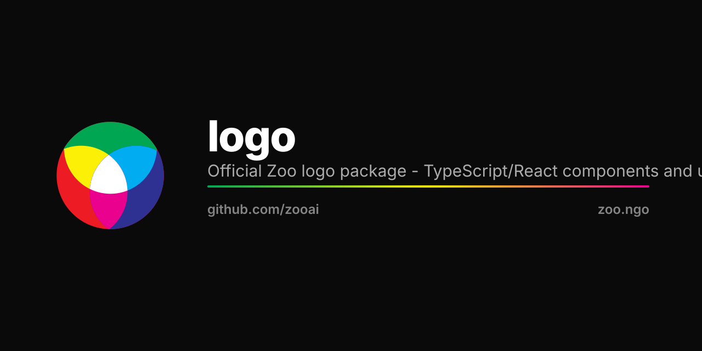

<p align="center">
  
</p>

# Logo Assets

Official logos and marks.

## Formats

- `svg/` - Vector formats (preferred)
- `png/` - Raster formats (various sizes)
- `ico/` - Favicon formats

## Variants

- Primary logo
- Wordmark
- Icon/Symbol
- Monochrome (light/dark)

## Usage

See [brand guidelines](../brand) for proper usage.

## Download

All assets available in this repository.

## License

All rights reserved. Usage requires permission.

## Animated & interactive

The mark ships a self-contained, **pure-CSS animated SVG** — a load animation, a
hover flourish, and a press squash, with **zero JavaScript**. Inline it into the DOM
(not via ``) for the hover/press interactions to fire. Honors `prefers-reduced-motion`.

```tsx
// React — one-line interactive embed
import { ZooLogo } from '@zooai/logo';
<ZooLogo variant="animated" size={64} />
```

```ts
// Vanilla / any framework
import { getAnimatedSVG, getAnimatedDataUrl } from '@zooai/logo';
el.innerHTML = getAnimatedSVG();   // interactive (inline in the DOM)
img.src = getAnimatedDataUrl();    // load animation only (fine in )
```

```html
<!-- Raw SVG over CDN — load animation in ; inline the file for hover/press -->

```
